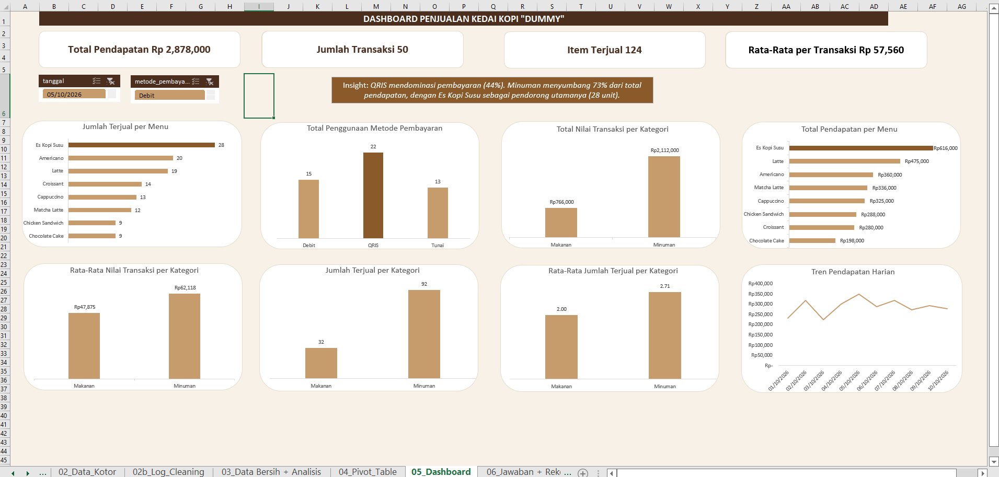

# Coffee Shop Sales Analysis (Excel)

An end-to-end data analysis project in Microsoft Excel: from messy raw data to a cleaned dataset, pivot tables, an interactive dashboard, and business recommendations.

> **Disclaimer:** This is a **dummy project built on fictional data** for portfolio and learning purposes. It does not represent a real business. The workbook itself is written in Indonesian.

---

## Table of Contents
- [Business Questions](#business-questions)
- [Dataset](#dataset)
- [Tools and Techniques](#tools-and-techniques)
- [Workbook Structure](#workbook-structure)
- [Data Cleaning](#data-cleaning)
- [Key Findings](#key-findings)
- [Recommendations](#recommendations)
- [Dashboard](#dashboard)
- [Assumptions and Limitations](#assumptions-and-limitations)
- [How to Use](#how-to-use)
- [Author](#author)

---

## Business Questions
1. Which menu item sells the most?
2. What is the total revenue from the Beverage category?
3. What is the average sales value per transaction?

## Dataset
| Item | Detail |
|---|---|
| Period | 1-10 October 2026 |
| Raw records | 53 rows |
| Clean records | 50 transactions |
| Menu items | 8 |
| Categories | 2 (Food, Beverage) |
| Payment methods | 3 (QRIS, Cash, Debit) |

Fields: `order_id`, `tanggal` (date), `nama_menu` (menu name), `kategori` (category), `harga_satuan` (unit price), `jumlah_terjual` (quantity sold), `metode_pembayaran` (payment method).

## Tools and Techniques
- **Microsoft Excel:** Tables, PivotTables, PivotCharts, Slicers, interactive dashboard
- **Functions:** `SUMIF`, `SUMIFS`, `AVERAGEIFS`, `MINIFS`, `MAXIFS`, `XLOOKUP`, `INDEX-MATCH`, `UNIQUE`, `SUMPRODUCT`
- **Cleaning functions:** `TRIM`, `PROPER`, `UPPER`, `SUBSTITUTE`, `VALUE`, Remove Duplicates, Find & Replace

## Workbook Structure
| Sheet | Content |
|---|---|
| `01_Pertanyaan` | Business questions |
| `02_Data_Kotor` | Raw data with intentional data quality issues |
| `02b_Log_Cleaning` | Cleaning log: issues, actions, rationale, and assumptions |
| `03_Data Bersih + Analisis` | Cleaned data and analysis calculations |
| `04_Pivot_Table` | PivotTables |
| `05_Dashboard` | Interactive dashboard (slicers and charts) |
| `06_Jawaban + Rekomendasi` | Answers, insights, recommendations, assumptions and limitations |
| `07_Dokumentasi_Rumus` | Formula documentation |

## Data Cleaning
The raw data contained **11 types of issues**, all documented in `02b_Log_Cleaning`:

| Issue | Example | Treatment |
|---|---|---|
| Inconsistent `order_id` format | `ord031`, `ORD028 ` | `TRIM`, `UPPER` |
| Duplicate records (3 rows) | ORD007, ORD023, ORD045 | Remove Duplicates (after ID cleanup) |
| Dates stored as text / one missing | `03/10/2026`, `04 Okt 2026` | Converted to dates; missing date inferred from neighboring orders |
| Inconsistent menu names (16 cells) | `latte`, `Capuccino`, `Choco Cake` | `TRIM`, `PROPER`, alias mapping |
| Inconsistent categories (7 cells) | `MAKANAN`, `Minuman ` | `TRIM`, `PROPER` |
| Unit price stored as text (6 cells) | `Rp32.000`, `22,000` | `SUBSTITUTE`, `VALUE` |
| Missing unit price (2 cells) | ORD029, ORD044 | Filled from the same menu item's price |
| Quantity as text or words (4 cells) | `3 pcs`, `dua` | Converted to numbers |
| Quantity outlier (1 cell) | `40` | Corrected to `4` (documented assumption) |
| Inconsistent payment methods (10 cells) | `Cash`, `QR Code`, `Kartu Debit` | Mapped to QRIS / Cash / Debit |

**Result:** 53 raw rows became 50 clean transactions, and every correction is traceable from the raw data itself.

## Key Findings
- **Best-selling item:** Es Kopi Susu (Iced Milk Coffee) with 28 units sold.
- **Beverage revenue:** IDR 2,112,000, about 2.8x Food revenue (IDR 766,000).
- **Average transaction value:** IDR 57,560.
- **Most-used payment method:** QRIS, 22 of 50 transactions (44%).
- **Weakest item:** Chocolate Cake is low on both units (9) and revenue (IDR 198,000). Chicken Sandwich also sold 9 units, but its higher price still yields healthier revenue (IDR 288,000).
- **Daily revenue:** ranged from IDR 224,000 to IDR 349,000. Because the number of orders was fixed at 5 per day, the difference is driven by value per order.

## Recommendations
These are preliminary and should be validated with a longer data history.

1. **Retain and promote Es Kopi Susu:** keep stock secure and consider a loyalty program (e.g., Buy 5 Get 1 Free).
2. **Test a bundle (coffee + croissant)** to lift food sales. The current data cannot confirm co-purchase patterns, so treat this as an experiment.
3. **Upsell add-ons** (extra shot, oat milk, snacks). Adding one item of about IDR 7,500 per transaction would raise the average to roughly IDR 65,000.
4. **Strengthen digital payments:** make sure QRIS is reliable and explore e-wallet cashback.
5. **Review Chocolate Cake** (taste and portion) and **keep Chicken Sandwich** for its revenue contribution.
6. **Track value per order** daily and check whether weekday vs. weekend patterns hold over a longer period.

## Dashboard

## Assumptions and Limitations
- The analysis is based on only **50 transactions over 10 days**.
- Each order is assumed to contain **one menu item**, so basket analysis (items bought together) is not possible.
- The quantity outlier (40 units, ORD038) was treated as a typo for 4 units.
- Recommendations are preliminary; at least 1-3 months of data is advisable before acting on them.

## How to Use
1. Download `coffee-shop-sales-analysis.xlsx`.
2. Open it in **Microsoft Excel 365 or 2021** (required for `UNIQUE` and `XLOOKUP`).
3. Start at `01_Pertanyaan` and follow the sheets in order. The dashboard is on `05_Dashboard`.

## Author
**Victorio Valentino**
Aspiring Data Analyst | Psychology Graduate (Universitas Lambung Mangkurat)
[LinkedIn](https://www.linkedin.com/in/victorio-valentino-1b47b0258)
